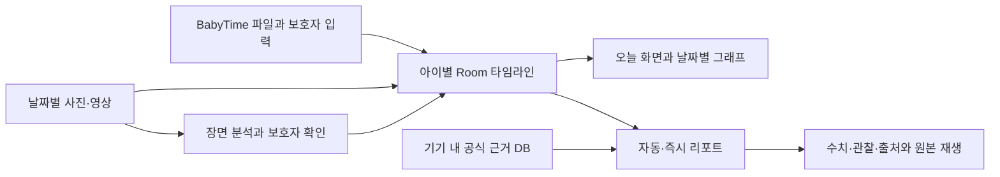

# 육아의나날 전체 설계

**대상은 국내 생후 0~71개월 아이를 돌보는 보호자다.** BabyTime에서 내보낸 기록에 보호자가 내용을 보충하면, 아이의 오늘 식사·배변·소변·수면을 보고 날짜별 사진과 영상을 함께 확인할 수 있다. 리포트는 기록이 충분한지, 평소와 무엇이 달랐는지, 어떤 장면이나 관찰을 상담에서 확인할지 알려준다.

앱은 촬영된 장면, 보호자가 확인한 관찰, 공식 검진 결과를 각자의 출처와 함께 보여준다. 첫 버전의 건강 기능은 기록 비교와 상담·검진 준비를 지원한다. 향후 질환 예측이나 진단을 제품 기능으로 제공하려면 의료진과 임상 성능을 검증하고, 국내 디지털의료기기 분류와 허가 해당 여부를 별도로 확인한다. [식약처 디지털의료제품 안내](https://emedi.mfds.go.kr/msismext/emd/bif/digitInfoIntrcnView.do)

## 1. 사용자 흐름과 화면

1. **시작**에서 아이와 생년월일을 등록하고 가족 시간대를 정한다. 기본 시간대는 `Asia/Seoul`이며, 출생일은 `D+0`으로 표시한다. 아이를 바꾸면 조회하는 기록과 미디어도 바뀐다.
2. **가져오기**에서 BabyTime 내보내기 파일을 선택하고 대상 아이와 변경 내역을 확인한다. **오늘** 화면에서 빠진 내용을 입력하거나 기존 기록에 메모·사진·영상을 붙인다.
3. **오늘**에서는 마지막 수유·배변 시각, 수유량·횟수, 이유식, 소변·대변, 수면, 사진·영상을 본다. **확인할 기록**을 누르면 미입력 값, 중복 후보, 비어 있는 시간, 분류 대기 미디어의 원본으로 이동한다. 보호자가 설정한 예정 항목은 시각이 지났는데 연결된 기록이 없을 때 별도로 표시한다.
4. **기록**은 최근 7일·30일 그래프가 기본이다. 분유·유축유(mL), 이유식(g), 배변·젖은 기저귀(회), 수면(시간)을 지표별로 바꾼다. 날짜 막대를 누르면 타임라인·상세 기록·사진과 영상·리포트가 함께 바뀐다. 달력은 특정 날짜로 이동할 때 사용한다.
5. **성장·발달**에서 실측 키·체중 그래프, 측정일, 생후 일수, 검진 일정과 보호자가 보관한 검진 결과를 본다. 관찰 메모나 영상 구간을 골라 진료에 가져갈 자료를 정리할 수 있다.
6. **리포트**에서 날짜별 자동 리포트를 열거나, 오늘 화면에서 요청 문구를 추가해 즉시 리포트를 만든다. **설정**에서 자동 생성 시각, 알림, AI 제공사·모델과 연결 상태를 관리한다.

## 2. BabyTime 가져오기와 기록 병합

**파일 선택 → 미리보기 → 중복 확인 → 반영 → 영향받은 날짜 재집계** 순서로 동작한다. 보호자가 안드로이드 파일 선택기로 내보내기 파일을 지정한다. 공개 사례에는 ZIP·TXT가 있지만 현재 BabyTime 안드로이드의 형식과 세부 필드는 실제 파일에서 확인한다. 다른 육아 앱도 같은 가져오기 인터페이스에 출처별 변환기를 붙일 수 있다. [Android 파일 선택](https://developer.android.com/training/data-storage/shared/documents-files) · [BabyTime 파일 가져오기 공개 사례](https://play.google.com/store/apps/details?hl=ko&id=com.pplenty.babylog)

| 상황 | 반영 규칙 |
| --- | --- |
| 처음 가져오기 | 대상 아이·기간·신규·수정·중복 후보·읽기 오류를 미리 보여준다. 원본 필드명과 단위, 발생 시각의 정밀도, 출처를 보존한다. |
| 동일 파일 재가져오기 | 아이·출처와 파일 해시로 중복을 확인한다. 진행 중이던 확인 항목은 기존 상태를 열고 신규 기록은 0건으로 처리한다. |
| 외부 ID가 같은 변경 기록 | 아이·출처 연결·외부 ID로 찾는다. 새 버전임을 확인한 값은 원본을 갱신한다. 순서를 판별하기 어려운 서로 다른 값은 확인 대상으로 둔다. |
| ID가 없고 수기 기록과 유사함 | 시각·유형·값으로 중복 후보를 보여준다. 기존 확정 건은 집계에 유지하고 새 후보는 보호자가 `같은 기록` 또는 `별도 기록`을 고를 때 반영한다. |
| 기존 기록에 메모·수치·사진 보완 | 외부 원본, 보호자 수정, 현재 집계값을 연결한다. 재가져온 뒤에도 보호자 보완값과 미디어 연결을 유지한다. |
| 일부 기간만 내보낸 새 파일 | 파일 기간을 출처에 저장한다. 이전에 확인한 기록의 수정·삭제는 신뢰할 수 있는 명시적 변경 정보나 보호자 선택으로 반영한다. |

예를 들어 가져온 `09:00 분유 120mL`를 보호자가 실제 섭취량 `100mL`로 수정하고, `10:30 분유 60mL`를 별도 수유로 추가하면 **2회·160mL**다. 가져온 120mL가 제공량인지 섭취량인지 확인되지 않으면 의미 미확인으로 표시하고 섭취량 집계는 보류한다.

가져오기 반영과 변경 날짜 등록은 한 DB 트랜잭션에서 처리한다. 날짜가 바뀐 기록은 이전 날짜와 새 날짜를 갱신한다. 지원을 표시하는 파일 형식은 실제 안드로이드 샘플에서 식별자·단위·시간대·수유 종류·수면 시작과 종료의 의미를 검증한 범위로 정한다.

## 3. 숫자와 기록 범위

모든 사건은 아이 ID, 발생 시각 또는 날짜, 시각 정밀도, 앱에 들어온 시각, 출처와 개정 번호를 가진다. 가족 시간대의 달력 날짜로 묶고, 시각이 있는 사건은 UTC 시각도 저장한다. 날짜만 확인된 자료는 그날 화면에 표시하고 시각이 필요한 비교에서는 따로 표시한다.

| 항목 | 리포트 입력과 계산 |
| --- | --- |
| 수유·식사 | 직접 모유수유 횟수·기록된 시간, 병 수유 실제 섭취량, 이유식 g을 구분한다. 제공량·실제 섭취량·의미 미확인, 실측·추정을 보존한다. 예를 들어 `병 수유 3회 중 섭취량이 기록된 2회의 합계 200mL`로 표시한다. |
| 대변·소변 | 같은 기저귀에서 소변·대변을 각각 있음·없음·미확인으로 저장한다. 보호자가 확인한 0회, 빈 기록, 모르는 상태를 구분한다. 색·굳기·메모와 사진을 연결할 수 있다. |
| 수면 | 시작·종료·진행 중·종료 미확인 상태를 보존한다. 겹치는 확인 구간을 합친 뒤 날짜 경계에서 분할한다. 자정을 걸친 `23:40~00:20`은 양쪽 날짜에 각 20분이다. |
| 성장·컨디션 | 키·체중 실측값, 단위, 측정일, 누운 길이·선 키, 측정 출처를 기록한다. 차이는 비교 가능한 실측이 두 번 이상일 때 표시한다. 체온은 쟀을 때 값·단위·시각·측정 부위를, 게워냄 등은 보호자 관찰로 선택 입력한다. |
| 분야별 기록 범위 | 수유·배변·수면 각각의 확인 시간과 공백을 저장한다. 가져오기 파일의 기간은 실제 돌봄 기록 범위와 별개다. 전체 범위가 확인되기 전에는 숫자에 `기록된 합계`를 붙인다. |

즉시 리포트는 같은 시각까지의 비교 가능한 과거 기록을 사용하고, 사용한 기간과 날짜 수를 보여준다. 월령, 수유 방식이나 기록 범위가 달라 비교하기 어려우면 그 이유를 표시한다. WHO 수면 참고 범위는 낮잠을 포함한 24시간 단위이며, 기록 범위가 확인된 하루치에 표시한다. [WHO 수면 지침](https://www.who.int/publications/i/item/9789241550536)

입력 필드, 누락 상태와 세부 예시는 [리포트 입력과 누락 처리](report-inputs.md)에 정의한다.

## 4. 사진·영상 보관함과 분석

**원본 선택 → 아이·촬영일에 연결 → 분석 후보 생성 → 보호자 확인 → 리포트에서 장면 열기**로 이어진다. 첫 버전은 Android Photo Picker에서 보호자가 선택한 사진·영상부터 지원한다. 앱은 접근할 수 있는 원본 참조, 촬영일, 영상 길이, 썸네일과 연결된 기록을 관리한다. 원본 접근 권한이 사라지면 카드에 상태를 표시하고 다시 연결할 수 있게 한다. [Android 사진·영상 선택](https://developer.android.com/training/data-storage/shared/photo-picker) · [Media3 재생](https://developer.android.com/media/media3/exoplayer)

- 그래프에서 날짜를 고르면 사진과 영상이 촬영일별로 표시된다. 리포트의 영상 카드를 누르면 해당 시점부터 재생한다. 원본 영상이 분석 대기 상태여도 날짜별 보관함에서 볼 수 있다.
- 사진은 화면에 보이는 장면을 묘사한다. 영상은 보호자가 고른 짧은 구간이나 대표 프레임에서 관찰 후보를 작성한다. 실제 분석한 프레임·구간, 화질이나 가림, 보호자 확인·수정을 구분한다. 음식의 실제 섭취량은 식사 기록에서, 배변 색과 상태는 확인한 입력에서, 수면 시간은 시작·종료 기록에서 가져온다. [Media3 프레임 추출](https://developer.android.com/media/media3/inspector/extract-frames) · [ML Kit 이미지 입력](https://developers.google.com/ml-kit/genai/prompt/android/get-started#provide_multimodal_image_and_text_input)
- 분석 키는 **파일 내용·분석 구간·분석 방법과 모델 버전**이다. 완료·제외·대기·실패를 구분한다. 이미 처리한 사진·영상은 같은 분석 키의 결과를 재사용한다. 촬영일을 고치면 날짜 연결과 리포트만 갱신한다.
- 앱 전체 갤러리의 자동 탐색을 추가할 때는 권한 범위 안에서 MediaStore의 저장소별 버전과 변경 지점을 사용한다. 후보와 체크포인트를 함께 저장하고, 목록을 다시 대조할 때도 완료 분석을 재사용한다. Play 배포의 광범위한 사진·영상 접근은 별도 권한 요건을 확인한다. [MediaStore 변경 감지](https://developer.android.com/training/data-storage/shared/media#detect-updates-to-media-files) · [Google Play 사진·영상 권한](https://support.google.com/googleplay/android-developer/answer/16935362)

## 5. 기기 내 육아 지식 DB

**공식 지침은 적용 조건과 참고 범위를, 원저 논문은 배경 설명을 제공한다.** 아이 기록과 공개 지식을 다른 저장소에 보관한다. 숫자와 적용 조건은 SQLite로 조회하고, 문단 검색에는 키워드 인덱스를 사용한다. 향후 벡터 인덱스는 다른 표현의 관련 관찰이나 근거를 찾는 데 사용하고, 원문은 저장소의 현재 ID와 버전으로 확인한다.

| 초기 자료 | 사용 범위 |
| --- | --- |
| 질병관리청 영유아 식이영양, WHO 2023 이유식 지침 | 식이 맥락과 수유 방식별 설명. WHO 이유식은 6~23개월. 개인의 일일 섭취량은 실제 기록과 비교한다. [질병관리청 식이영양](https://health.kdca.go.kr/healthinfo/biz/health/gnrlzHealthInfo/gnrlzHealthInfo/gnrlzHealthInfoView.do?cntnts_sn=5212) · [WHO 이유식 지침](https://www.who.int/publications/i/item/9789240081864) |
| 질병관리청 대변 이상, Solasaari 등 2024년 전향적 코호트 | 보호자 확인용 색·굳기와 진료 안내의 근거. 코호트는 생후 17주까지의 핀란드 만삭아 자료로, 월령·수유에 따른 차이를 설명한다. [질병관리청 대변 이상](https://health.kdca.go.kr/healthinfo/biz/health/gnrlzHealthInfo/gnrlzHealthInfo/gnrlzHealthInfoView.do?cntnts_sn=5722) · [배변 코호트](https://link.springer.com/article/10.1007/s00431-024-05625-0) |
| WHO 2019 수면, AASM 2016 합의문, AAP 영아 안전수면 | 낮잠을 포함한 24시간 참고 범위는 WHO에서 `0~3개월 14~17시간`, `4~11개월 12~16시간`, `12~35개월 11~14시간`, `36~59개월 10~13시간`. 앱의 60~71개월 범위에는 AASM 3~5세 권고인 10~13시간과 그 출처를 표시한다. AAP 자료는 영아 수면 환경을 설명할 때 사용한다. [WHO 수면](https://iris.who.int/bitstream/handle/10665/325147/WHO-NMH-PND-2019.4-eng.pdf) · [AASM 합의문](https://pmc.ncbi.nlm.nih.gov/articles/PMC4877308/) · [AAP 안전수면](https://www.healthychildren.org/English/news/Pages/safe-sleep-back-is-best-avoid-soft-bedding-inclined-surfaces-and-bedsharing.aspx) |
| 2017 소아청소년 성장도표, 공단 LMS 자료 | 측정일·월령·성별·방법에 맞는 기준값을 사용한다. 2017판은 0~35개월에 WHO 기준을, 36개월부터 국내 기준을 적용한다. 개정판은 공식 발표와 계산 검증 후 새 판본으로 도입한다. [질병관리청 성장도표](https://www.kdca.go.kr/kdca/5458/subview.do) · [NHIS LMS CSV](https://www.data.go.kr/data/15133061/fileData.do) · [공식 계산기](https://knhanes.kdca.go.kr/knhanes/grtcht/main.do) |
| 공단 영유아 검진, K-DST 지침·검증 논문, CDC 발달 관찰 안내 | 국내 일반검진 일정은 생후 14~35일 및 4~6·9~12·18~24·30~36·42~48·54~60·66~71개월이다. K-DST 도구의 표준화 범위 4~71개월과 국가검진 발달선별검사지가 시작되는 3차 9~12개월을 구분한다. 실제 결과와 상담·추적 안내에 연결한다. [공단 검진 안내](https://www.nhis.or.kr/renewal_popup/poster/20261013_poster_longdesc_1.html) · [K-DST 검증 논문](https://doi.org/10.3345/cep.2020.00640) · [CDC 발달 관찰](https://www.cdc.gov/act-early/milestones/) |

지식 항목에는 출처·판본·문서 내 위치·이용 조건·검토 상태와 함께 **적용 나이의 단위, 하한·상한, 출생 후 나이 또는 교정연령, 적용 조건, 지표·단위·관찰 기간**을 저장한다. 예를 들어 WHO 4~11개월 수면 항목은 `4개월 이상, 12개월 미만`이다. 성장에는 측정일, 영상에는 촬영일 당시 월령을 적용한다. 교정연령은 해당 지침과 아이 프로필의 입력 조건을 충족할 때 사용한다.

첫 설치에 검토된 `knowledge.db`를 포함한다. 설치 후 공개 배포 목록의 서명과 변경 파일 해시·스키마를 검증하고, 함께 작동하는 자료와 인덱스를 한 버전으로 활성화한다. 중단되면 기존 검증본을 사용하고, 철회가 확인된 기준은 이후 리포트에서 제외한다. 이 동기화의 생성형 AI 토큰 사용량은 0이다. 초기 묶음에는 출처 링크, 독립 작성한 검토 설명, 수록 가능한 구조화 데이터를 사용한다. 지침서 원문·검사 문항·번역·이미지의 배포 가능 여부는 자료별로 검토한다. [Room 초기 DB 배포](https://developer.android.com/training/data-storage/room/prepopulate) · [K-DST 지침서와 이용 조건](https://www.kdca.go.kr/kdca/2861/subview.do?enc=Zm5jdDF8QEB8JTJGYmJzJTJGa2RjYSUyRjU1JTJGMjI3NjExJTJGYXJ0Y2xWaWV3LmRvJTNG) · [PMC 자료별 이용 조건](https://pmc.ncbi.nlm.nih.gov/tools/openftlist/)

## 6. 리포트 생성과 상담 안내

| 구분 | 자동 데일리 | 즉시 |
| --- | --- | --- |
| 요청 | 보호자가 아이별로 설정한 가족 시간대의 목표 시각. 완료 알림은 날짜당 한 번 | 오늘 화면의 생성 버튼. 원하는 문구와 사용할 수 있는 모델 선택 |
| 대상 자료 | 예약 대상 날짜의 자정부터 생성 시작까지. 자정을 넘어 실행되면 예약 날짜 자정부터 다음 날 자정까지 | 오늘 자정부터 누른 시각까지. 요청에 포함된 자료 버전을 함께 고정 |
| 저장 | 아이와 대상 날짜를 키로 기본 리포트를 유지. 뒤늦은 사진·기록은 그 날짜와 영향을 받는 비교를 갱신 | 요청 시각, 추가 입력, 당시 자료 범위를 별도 이력으로 저장. 새 요청은 바뀐 자료를 사용 |

리포트 생성은 **자료 범위 확정 → 수치 집계 및 기록 누락 계산 → 월령·조건이 맞는 근거 조회 → 미디어 관찰 연결 → 문장과 출처 표시** 순서다. 수치는 앱에서 계산한다. AI를 사용할 때는 집계, 관련 지식 몇 문단, 저장된 미디어 관찰만 전달하고, 앱이 계산한 수치와 결정한 안내 상태를 화면에 직접 표시한다. 보호자가 즉시 리포트에 적은 말은 `이번 요청의 보호자 메모`로 구분한다.

리포트에는 아래 항목을 독립적으로 표시한다.

- **기록 범위와 평소 대비 변화**는 사용한 시간, 입력 건수와 비교 기간을 보여준다. 자료가 부족하면 보충할 필드로 이동한다.
- **사진·영상에서 확인할 장면**은 썸네일과 확인할 시점을 보여준다. AI 관찰 후보나 분석 범위를 표시하고 보호자가 수정·확인할 수 있게 한다.
- **상담 때 확인할 내용**은 보호자가 표시한 걱정, 실제 검진 결과, 또는 의료진이 검토한 적용 가능한 기준에 연결한다. 이전에 하던 행동을 잃었다는 보호자 기록처럼 상담 안내가 필요한 경우, 해당 기록 화면에서 먼저 안내하고 리포트에도 싣는다. [CDC 발달 상담 안내](https://www.cdc.gov/act-early/milestones/) · [공단 발달정밀검사 안내](https://www.nhis.or.kr/renewal_popup/poster/20261013_poster_longdesc_1.html)

예를 들어 **“병 수유 3회 중 실제 섭취량이 기록된 2회 합계는 200mL. 13:00~16:00 어린이집 수유 자료는 미확인.”** 아래에 **“14:10 영상 00:08~00:13 장난감을 손으로 집는 장면 · 보호자 확인 대기”**를 같은 날짜의 근거로 붙인다. 항목마다 원본 기록과 영상 구간, 적용한 공식 자료 중 연결된 근거를 열 수 있어야 한다.

다음 예약 시각은 가족 시간대의 달력으로 계산하고, 재시도에도 예약 날짜를 유지한다. WorkManager의 실행은 배터리와 시스템 조건에 따라 지연될 수 있다. **ML Kit Gemini Nano는 앱이 화면에 열려 있을 때만 새 분석을 실행할 수 있다.** 자동 배치는 기기 내 집계·공식 근거·저장된 관찰로 리포트를 만들고, 새 분석은 앱에서 완료된 뒤 반영한다. [WorkManager 예약과 지연](https://developer.android.com/develop/background-work/background-tasks/persistent/getting-started/define-work#delayed-work) · [ML Kit 백그라운드 사용 조건](https://developers.google.com/ml-kit/genai#background_usage)

## 7. 기술 구조와 데이터 보관

| 구성 | 책임 |
| --- | --- |
| Kotlin·Jetpack Compose | 화면, 빠른 입력, UI 상태, 사진·영상 선택과 재생 |
| Room 기록 DB | 아이·기록·원본·가져오기·기록 범위·실측·메모·질문을 저장한다. `media_asset`과 `child_media`로 원본과 아이·날짜를 연결하고, `media_analysis`에 분석 결과와 버전을 둔다. `report_schedule`, `report_request`, `daily_report`, `report_source`로 일정·이력·기본 리포트·근거를 관리한다. |
| 별도 육아 지식 DB | `evidence_source`, `evidence_item`, `reference_value`, `guidance_rule`, `knowledge_release`와 키워드 검색. 벡터 도입 시 공개 지식 인덱스와 아이 기록 인덱스를 분리 |
| WorkManager | 예약 리포트, 파일 동기화, 재시도, 미디어 탐색 작업. 일정과 사진 입력이 바뀌면 영향을 받는 날짜만 갱신 |
| AI 연결 | 지원 기기의 Gemini Nano 또는 기록 기반 리포트. 선택 가능한 클라우드 연결은 Spring Boot가 API 키를 보관하고 예시 데이터로 테스트할 수 있게 구성 |

앱 화면과 백그라운드 작업은 동일한 Kotlin 서비스에서 날짜 조회·기록 수정·리포트 요청을 수행한다. 향후 자연어 명령을 추가하면 AI가 날짜 조회, 관련 기록 검색, 리포트 생성 같은 정해진 동작을 요청할 수 있다. 기록 작성은 보호자가 확인할 수 있는 초안을 만든 뒤 저장한다.

아이별 데이터는 기기 내부에 두고, 사진 원본은 보호자가 선택한 갤러리 참조를 사용한다. 첫 버전의 클라우드 연결 테스트는 합성 데이터로 진행한다. 실제 아이 자료의 전송은 제공사 조건·전송 범위·저장 위치·백업을 확인하고 별도로 활성화하는 범위다. OpenAI의 아동 개인정보 가이드에는 적용 연령의 아동 데이터를 처리하기 전 API Zero Data Retention 지침이 있고, Gemini 무상 서비스에는 개인정보·민감정보 입력 제한이 있다. 비공개 기록과 분석 결과는 기본 자동 클라우드 백업에서 제외하도록 구성하고, Android의 기기 간 이전 설정과 동작도 출시 전에 확인한다. [OpenAI 아동 데이터 가이드](https://developers.openai.com/api/docs/guides/safety-checks/under-18-api-guidance) · [Gemini API 약관](https://aistudio.google.com/docs/terms#data-use-unpaid) · [Android 자동 백업](https://developer.android.com/identity/data/autobackup)

같은 입력의 미디어 분석과 리포트 결과를 재사용한다. 리포트 입력에는 원본과 분석의 개정 번호, 자료 범위, 추가 입력, 지식·규칙·모델 버전이 포함된다. 작업 완료 시 현재 입력 버전을 확인한 뒤 결과를 표시한다. 수정·삭제는 관련 날짜와 검색 갱신으로 이어지고, 삭제한 자료를 인용한 리포트 문장과 썸네일도 기본 리포트와 이력에서 정리한다.

## 8. 첫 버전과 후속 범위

| 첫 버전 | 후속 |
| --- | --- |
| 아이 프로필, 생후 일수, BabyTime 파일 가져오기·미리보기·중복 확인, 직접 입력·보완 | 다른 육아 앱의 파일 변환기와 공식 연동 |
| 오늘과 확인할 기록, 7일·30일 그래프와 날짜 선택, 달력, 실측 성장, 검진 일정·결과 메모 | 양육자 인계용 요약·공유와 여러 기기 동기화 |
| 선택한 사진·영상의 날짜별 보관함, 장면 분석 후보와 보호자 확인, 리포트에서 직접 재생 | 권한을 받은 전체 갤러리 자동 탐색, 연속 영상·음성 분석의 성능 검증 |
| 기본 지식 묶음·버전 동기화, 월령·조건 조회, 키워드 검색, 육아 메모·질문 보관 | AndroidX AppSearch 기반 의미 검색, 한국어 임베딩 품질 비교 |
| 예약·즉시 리포트, 기기 내 AI 설정과 기기 지원 확인, 연결 전에도 기록 기반 리포트, 가상 자료로 클라우드 연결 검증 | 클라우드 실제 자료 처리 조건 충족 후 제공사 선택 확장 |

첫 버전의 핵심 시연은 **BabyTime 파일에서 하루를 가져오고 → 빠진 섭취량을 보완하고 → 그래프에서 날짜를 누르고 → 그날의 사진·영상과 근거가 연결된 리포트를 여는 것**이다.

## 9. 개발 순서와 완료 조건

| 순서 | 개발 작업 | 완료 조건 |
| --- | --- | --- |
| **0. 자료와 기기 확인** | 개인정보가 가려진 실제 BabyTime 안드로이드 파일, 대상 폰의 AI·동영상 지원, 지식 수록 조건을 확인 | 샘플의 필드·단위·시간대 매핑과 지원 기기 범위를 문서화. 확인 전에는 시험용 파일과 수기 기록으로 개발 진행 |
| **1. 기록과 계산 기반** | Room 스키마, 날짜와 시각, 수기 입력, 분야별 기록 범위, 일별 집계 구현 | 제공량과 실제 섭취량 구분, 미입력과 0회 구분, 자정 수면 분할과 중복 구간 제거 |
| **2. 파일과 그래프** | BabyTime 변환기·미리보기·병합과 오늘 화면, 날짜별 기록 그래프 구현 | 같은 파일 재가져오기 신규 0건, 보호자 수정과 미디어 연결 유지, 선택한 날짜의 화면이 함께 변경 |
| **3. 사진·영상** | 선택기, 보관함, 구간 재생, 분석 상태·캐시와 보호자 확인 구현 | 같은 사진·구간·분석 버전 재분석 0회, 촬영일을 정정하면 두 날짜 갱신, 권한 해제·삭제 후 관련 표시 정리 |
| **4. 지식과 기본 리포트** | 초기 지식 DB, 출처 연결, 월령 조회, 성장·검진, 상담 안내, 기기 내 기록 기반 리포트 구현 | 월령 경계와 24시간 자료 범위를 올바르게 적용, 공식 성장 계산기와 대조, 지식 갱신 실패 시 기존 검증본으로 동작 |
| **5. 예약과 AI** | 자동 스케줄, 즉시 요청과 추가 입력, 모델 설정, 기기 내 분석 연동 | 자정 이후에 실행돼도 예약 날짜 유지, 중복 알림 방지, 즉시 요청의 자료 버전 보존, AI 연결 없이 리포트 열람 |
| **6. 출시 확인** | 실기기에서 수기·가져오기·미디어·오프라인·권한 복구 흐름을 끝까지 확인 | 검증한 BabyTime 형식과 기기만 지원 범위에 명시하고, 자동 상담 문구는 의료진이 적용 조건을 검토한 것부터 활성화 |

첫 구현에는 실제 BabyTime 파일, LMS CSV 수치 검증, 대상 휴대폰에서의 한국어·영상 장면 품질 확인이 필요하다. 이 세 항목은 기록과 기본 리포트 구현을 진행하면서 병행할 수 있다.
